<!-- Claude palette: coral #D97757 · deep coral #C15F3C · ink #1F1E1D · cream #F0EEE6 -->

  

  

  
  
  
  

  

## Now building

<table>
  <tr>
    <td width="52%" valign="middle">
      
    </td>
    <td width="48%" valign="top">
      <h3><a href="https://notedm.com">NoteDM</a></h3>
      
<b>Make it. Post it. Reply to it.</b>

      
Turns Instagram comments into DMs and sales, and makes cinematic AI video to post in the first place.

      <ul>
        <li><b>Comment-to-DM rules:</b> someone comments on a reel and NoteDM posts a public reply and sends them a DM with your link</li>
        <li><b>AI Studio:</b> cinematic video and images, rendered on your own Higgsfield account</li>
        <li><b>Scheduling:</b> to Instagram and YouTube</li>
        <li><b>Link insights:</b> click and conversion tracking with commission totals</li>
      </ul>
      
      
      
    </td>
  </tr>
  <tr>
    <td colspan="2" valign="top">
      <h3><a href="https://github.com/AshishChikane/sol-security-transaction">SignSafeli: AI firewall for Solana</a></h3>
      
Checks a transaction before you sign it. It simulates the transaction, scores it with a hybrid rules and LLM engine, and explains the risk in plain English, targeting under 300ms. Ships as a browser extension for Phantom, Backpack and Solflare, a dApp SDK, and middleware for AI agents such as Solana Agent Kit and ElizaOS.

          
    </td>
  </tr>
</table>

## What I focus on

<table>
  <tr>
    <td width="50%" valign="top">
      <h3>AI / ML</h3>
      <ul>
        <li><b>LLM agents:</b> multi-agent pipelines that research, enrich and write structured data</li>
        <li><b>LLM apps:</b> FastAPI services with LangChain, Groq and Claude</li>
        <li><b>MCP servers:</b> tools that plug models into real systems</li>
        <li><b>LLM security:</b> guardrails, redaction and logging for AI tools</li>
        <li><b>Secure MLOps:</b> PyTorch training behind secret, dependency and model scanners</li>
        <li><b>Generative media:</b> AI video and image generation in NoteDM's AI Studio</li>
      </ul>
    </td>
    <td width="50%" valign="top">
      <h3>Blockchain</h3>
      <ul>
        <li><b>Solana security:</b> simulating and risk-scoring transactions before they are signed</li>
        <li><b>Smart contracts:</b> Solidity contracts for batch payouts on EVM chains</li>
        <li><b>Wallet infrastructure:</b> Turnkey embedded wallets with email OTP, signing through ethers and viem</li>
        <li><b>AI x crypto:</b> guardrails for autonomous agents that hold keys and sign transactions</li>
        <li><b>dApp frontends:</b> React and TypeScript interfaces for wallet flows</li>
      </ul>
    </td>
  </tr>
</table>

## Tech stack

<b>AI / ML</b>

  
   
  
  
  
  
  
  

<b>Blockchain</b>

  
   
  
  
  
  
  
  

<b>Product and infrastructure</b>

  

## Featured projects

<table>
  <tr>
    <td width="50%" valign="top">
      <h3><a href="https://github.com/AshishChikane/Call-center-leads-scraping">Contact Discovery Agent</a></h3>
      
A multi-agent B2B lead pipeline. It sources target companies, finds decision-makers through Hunter.io, adds company data with citation links, and writes the approved rows to Google Sheets.

        
    </td>
    <td width="50%" valign="top">
      <h3><a href="https://github.com/AshishChikane/mlops-hardened-pipeline-poc">Hardened MLOps pipeline</a></h3>
      
A security-gated ML pipeline. It trains a PyTorch model, runs secret, dependency and model scanners, and lets a gatekeeper step decide whether the pipeline passes.

        
    </td>
  </tr>
  <tr>
    <td width="50%" valign="top">
      <h3><a href="https://github.com/AshishChikane/TurnKey-Agent">Turnkey wallet agent</a></h3>
      
Embedded wallets built on Turnkey. Users sign in with an email OTP, each user gets their own sub-organization, and transactions are signed through ethers and viem.

         
    </td>
    <td width="50%" valign="top">
      <h3><a href="https://github.com/AshishChikane/prediction_market_bot">Prediction Market Bot API</a></h3>
      
A FastAPI service that uses LangChain and Groq to decide which side a bet favors. It returns a confidence level and its reasoning.

        
    </td>
  </tr>
  <tr>
    <td width="50%" valign="top">
      <h3><a href="https://github.com/AshishChikane/cli-agent-logger">AI CLI Logger</a></h3>
      
A background service that records sessions from Claude Code, Gemini CLI and other AI coding CLIs. Records pass through a redaction step and are deduplicated into a local store, which can ship them to a remote sink.

        
    </td>
    <td width="50%" valign="top">
      <h3><a href="https://github.com/AshishChikane/mcp-demo-workflow">MCP server workflow</a></h3>
      
A Model Context Protocol server built with FastMCP and served over HTTP, so models can call your tools directly.

        
    </td>
  </tr>
</table>

<b>More projects</b>

 

| Project | What it does | Stack |
| :-- | :-- | :-- |
| [BulkTransfer-crypto](https://github.com/AshishChikane/BulkTransfer-crypto) | Sends funds to many wallets in one smart contract call (EVM / Avalanche) | Solidity, Ethers.js |
| [sdk-python-node](https://github.com/AshishChikane/sdk-python-node) | The same SDK written for both Python and Node | TypeScript, Python |
| [chatbox-underwriter](https://github.com/AshishChikane/chatbox-underwriter) | Underwriting chatbot prototype | Python |
| [Image-to-video](https://github.com/AshishChikane/Image-to-video-frontend) | Image-to-video generation app ([backend](https://github.com/AshishChikane/Image-to-video-backend)) | React, Node |
| [Frontend-dev-skills-react](https://github.com/AshishChikane/Frontend-dev-skills-react) | Claude Code plugin with 5 React skills (init, feature, component, audit, standards) | Claude Code |
| [Business-pitch-skills](https://github.com/AshishChikane/Business-pitch-skills) | Claude Code plugin that builds prospect lists and writes cold email sequences | Claude Code |
| [marketing-skills-audit](https://github.com/AshishChikane/marketing-skills-audit) | Claude Code plugin that audits websites for SEO, AEO and GEO | Claude Code |
| [linkedin-automation-claude](https://github.com/AshishChikane/linkedin-automation-claude) | Claude Code skill for LinkedIn posting and profile management | Shell, Rube MCP |
| [publix-flask-backend](https://github.com/AshishChikane/publix-flask-backend) | Flask API with Kubernetes and Terraform deployment configs | Python, K8s, Terraform |

## Connect

  
  
  
  
  

  

