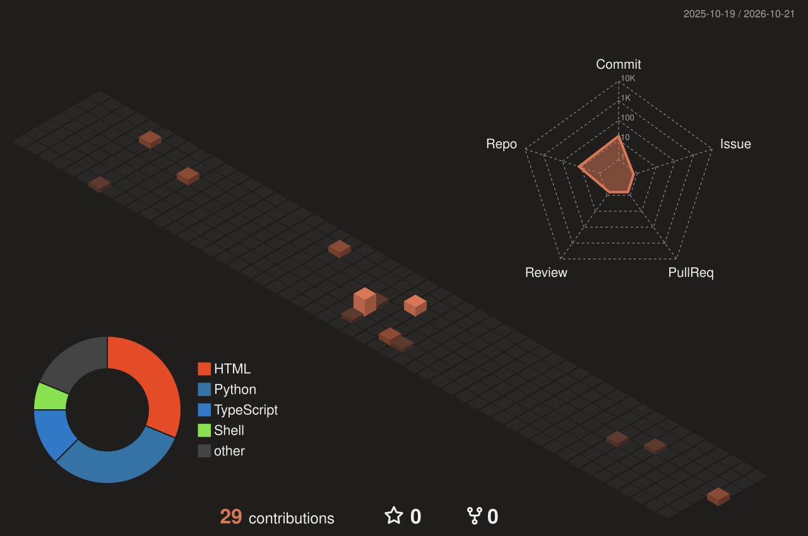

<!-- Claude palette: coral #D97757 · deep coral #C15F3C · ink #1F1E1D · cream #F0EEE6 -->

  

  

  
  
  
  

  

## Now building

<table>
  <tr>
    <td width="52%" valign="middle">
      
    </td>
    <td width="48%" valign="top">
      <h3><a href="https://notedm.com">NoteDM</a></h3>
      
<b>Make it. Post it. Reply to it.</b>

      
Turns Instagram comments into DMs and sales, and makes cinematic AI video to post in the first place.

      <ul>
        <li><b>Comment-to-DM rules:</b> someone comments on a reel and NoteDM posts a public reply and sends them a DM with your link</li>
        <li><b>AI Studio:</b> cinematic video and images, rendered on your own Higgsfield account</li>
        <li><b>Scheduling:</b> to Instagram and YouTube</li>
        <li><b>Link insights:</b> click and conversion tracking with commission totals</li>
      </ul>
      
      
      
    </td>
  </tr>
  <tr>
    <td colspan="2" valign="top">
      <h3><a href="https://github.com/AshishChikane/sol-security-transaction">SignSafeli: AI firewall for Solana</a></h3>
      
Checks a transaction before you sign it. It simulates the transaction, scores it with a hybrid rules and LLM engine, and explains the risk in plain English, targeting under 300ms. Ships as a browser extension for Phantom, Backpack and Solflare, a dApp SDK, and middleware for AI agents such as Solana Agent Kit and ElizaOS.

          
    </td>
  </tr>
</table>

## About me

- **Full-stack builder.** React and TypeScript frontends, Node and Python APIs, and the LLM logic that ties them together.
- **Security-minded.** Transaction firewalls, LLM guardrails, secret and dependency scanners, and hardened ML pipelines.
- **Claude Code power user.** I publish plugins and skills for React development, sales prospecting, website audits and LinkedIn automation.
- **5+ years on GitHub,** from React dashboards and booking apps to smart contracts, AI agents and security tooling.

## Tech stack

  
   
  
   
  

  
  
  
  
  
  
  
  

## Featured projects

<table>
  <tr>
    <td width="50%" valign="top">
      <h3><a href="https://github.com/AshishChikane/cli-agent-logger">AI CLI Logger</a></h3>
      
A background service that records sessions from Claude Code, Gemini CLI and other AI coding CLIs. Records pass through a redaction step and are deduplicated into a local store, which can ship them to a remote sink. Adding a new source takes one file.

       
    </td>
    <td width="50%" valign="top">
      <h3><a href="https://github.com/AshishChikane/Frontend-dev-skills-react">React Frontend Dev plugin</a></h3>
      
A Claude Code plugin with 5 skills: <code>/react-init</code>, <code>/react-feature</code>, <code>/react-component</code>, <code>/react-audit</code> and <code>/react-standards</code>. Before it generates code, it reads the project's existing conventions so it doesn't break an established codebase.

        
    </td>
  </tr>
  <tr>
    <td width="50%" valign="top">
      <h3><a href="https://github.com/AshishChikane/Business-pitch-skills">Sales Leads Engine</a></h3>
      
Turns a startup description into segmented prospect lists, investor lists and role-specific cold emails with 5-step follow-up sequences. It can also send the emails from Gmail, Outlook, Yahoo or Zoho.

       
    </td>
    <td width="50%" valign="top">
      <h3><a href="https://github.com/AshishChikane/marketing-skills-audit">Website Audit (SEO / AEO / GEO)</a></h3>
      
Runs 60+ checks across 6 categories and produces a scored, interactive HTML report with recommendations ranked by priority.

       
    </td>
  </tr>
  <tr>
    <td width="50%" valign="top">
      <h3><a href="https://github.com/AshishChikane/Call-center-leads-scraping">Contact Discovery Agent</a></h3>
      
A multi-agent B2B lead pipeline. It sources target companies, finds decision-makers through Hunter.io, adds company data with citation links, and writes the approved rows to Google Sheets.

       
    </td>
    <td width="50%" valign="top">
      <h3><a href="https://github.com/AshishChikane/mlops-hardened-pipeline-poc">Hardened MLOps pipeline</a></h3>
      
A security-gated ML pipeline. It trains a model, runs secret, dependency and model scanners, and lets a gatekeeper step decide whether the pipeline passes.

       
    </td>
  </tr>
  <tr>
    <td width="50%" valign="top">
      <h3><a href="https://github.com/AshishChikane/prediction_market_bot">Prediction Market Bot API</a></h3>
      
A FastAPI service that uses LangChain and Groq to decide which side a bet favors. It returns a confidence level and its reasoning.

       
    </td>
    <td width="50%" valign="top">
      <h3><a href="https://github.com/AshishChikane/linkedin-automation-claude">LinkedIn Automation skill</a></h3>
      
A Claude Code skill for publishing posts, commenting, uploading images and managing your profile on LinkedIn through Rube MCP. Installs with one command.

       
    </td>
  </tr>
</table>

<b>More projects</b>

 

| Project | What it does | Stack |
| :-- | :-- | :-- |
| [BulkTransfer-crypto](https://github.com/AshishChikane/BulkTransfer-crypto) | Sends funds to many wallets in one smart contract call (EVM / Avalanche) | Node, Ethers.js, Solidity |
| [TurnKey-Agent](https://github.com/AshishChikane/TurnKey-Agent) | Turnkey wallet integration with email OTP auth | Node, React |
| [sdk-python-node](https://github.com/AshishChikane/sdk-python-node) | The same SDK written for both Python and Node | TypeScript, Python |
| [mcp-demo-workflow](https://github.com/AshishChikane/mcp-demo-workflow) | Demo MCP server over HTTP using FastMCP | Python |
| [publix-flask-backend](https://github.com/AshishChikane/publix-flask-backend) | Flask API with Kubernetes and Terraform deployment configs | Python, K8s, Terraform |
| [chatbox-underwriter](https://github.com/AshishChikane/chatbox-underwriter) | Underwriting chatbot prototype | Python |
| [Image-to-video](https://github.com/AshishChikane/Image-to-video-frontend) | Image-to-video generation app ([backend](https://github.com/AshishChikane/Image-to-video-backend)) | React, Node |
| [react-app-jenkins](https://github.com/AshishChikane/react-app-jenkins) | React app with a Jenkins CI/CD pipeline | React, Jenkins |
| [payment-cashfree-dashboard](https://github.com/AshishChikane/payment-cashfree-dashboard) | Payments dashboard integrated with Cashfree | React |
| [booking_app](https://github.com/AshishChikane/booking_app_frontend) | Full-stack booking app ([backend](https://github.com/AshishChikane/booking_app_backend)) | React, Node |

## GitHub stats

  
  

  

<!-- Generated daily by .github/workflows/profile-3d.yml -->

  

<!-- Generated daily by .github/workflows/snake.yml -->

  <picture>
    <source media="(prefers-color-scheme: dark)" srcset="https://raw.githubusercontent.com/AshishChikane/AshishChikane/output/github-snake-dark.svg" />
    <source media="(prefers-color-scheme: light)" srcset="https://raw.githubusercontent.com/AshishChikane/AshishChikane/output/github-snake.svg" />
    
  </picture>

## Connect

  
  
  
  
  

  

